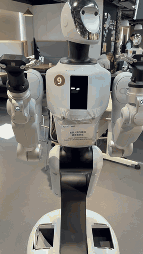

<div align="center">

# 银河通用开拓者训练营 · 香港

### Galbot G1 人形机器人具身智能开发实践

**从硬件与 SDK，到多传感器感知、机械臂操作与移动抓取**



<sub>训练营现场演示｜由现场视频转换，2× 播放｜演示画面不代表本仓库自主策略的评测结果</sub>

<br/><br/>


[项目亮点](#项目亮点) · [课程体系](#课程体系) · [实机记录](#实机记录) · [快速开始](#快速开始) · [学习收获](#学习收获)

</div>

---

> 围绕银河通用 **Galbot G1 轮式人形机器人**，将训练营中的硬件认知、SDK 接口探索、状态反馈与传感器实验整理为可阅读、可运行、可追溯的学习项目。重点是理解具身智能从“感知世界”到“执行动作”之间需要哪些工程环节。

## 项目亮点

| 实践方向 | 项目产出 | 展示的能力 |
| :--- | :--- | :--- |
| **机器人开发与状态理解** | 关节状态、7 关节角与末端 7 维位姿对照 | 理解硬件、SDK、控制服务和运动学表示的关系 |
| **多传感器数据探索** | 5 个分步脚本，覆盖 IMU、雷达和 8 方向超声波 | 按需启用、字段解析、时间戳检查与异常分析 |
| **可追溯的实机实验** | 30 条 IMU 记录、点云布局与综合检查摘要 | 用数据解释现象，区分缓存、噪声、无效值与标定偏差 |
| **面向具身智能的系统理解** | 感知、操作、导航与 VLA 执行层笔记 | 将单个 API 放回完整的机器人任务流程中理解 |

## 课程体系

依据[银河通用官方入门课程](https://developer.galbot.com/training/course/?level=beginner&lesson=01_%E5%88%9D%E8%AF%86Galbot%20G1&lang=zh)组织，课程名称可直达官方讲义，“笔记”链接进入本项目整理。

### DAY 1 — 机器人认知与控制基础

| 节次 | 官方课程 | 学习重点 | 项目笔记 |
| :---: | :--- | :--- | :---: |
| **01** | [初识 Galbot G1](https://developer.galbot.com/training/course?level=beginner&lesson=01_%E5%88%9D%E8%AF%86Galbot%20G1&lang=zh) | 硬件分工、机器人工作空间与操作边界 | [笔记](docs/engineering/hardware-sdk.md) |
| **02** | [开发环境搭建](https://developer.galbot.com/training/course?level=beginner&lesson=02_%E5%BC%80%E5%8F%91%E7%8E%AF%E5%A2%83%E6%90%AD%E5%BB%BA&lang=zh) | HPU 开发环境、Python SDK 与状态查询 | [笔记](docs/engineering/hardware-sdk.md) |
| **03** | [关节限位认知](https://developer.galbot.com/training/course?level=beginner&lesson=03_%E5%85%B3%E8%8A%82%E9%99%90%E4%BD%8D%E8%AE%A4%E7%9F%A5&lang=zh) | URDF、关节轴向、限位与坐标定义 | [笔记](docs/engineering/control-manipulation.md) |
| **04** | [基础关节控制](https://developer.galbot.com/training/course?level=beginner&lesson=04_%E5%85%B3%E8%8A%82%E6%8E%A7%E5%88%B6%E5%9F%BA%E7%A1%80&lang=zh) | 关节组、角度单位与完整状态回读 | [笔记](docs/labs/joint-state.md) |
| **05** | [末端执行器控制](https://developer.galbot.com/training/course?level=beginner&lesson=05_%E6%9C%AB%E7%AB%AF%E6%89%A7%E8%A1%8C%E5%99%A8%E6%8E%A7%E5%88%B6&lang=zh) | 末端位姿、四元数与夹爪参数 | [笔记](docs/labs/end-effector-pose.md) |
| **06** | [运动规划基础](https://developer.galbot.com/training/course?level=beginner&lesson=06_%E8%BF%90%E5%8A%A8%E8%A7%84%E5%88%92%E5%9F%BA%E7%A1%80&lang=zh) | FK / IK、目标姿态与轨迹约束 | [笔记](docs/engineering/control-manipulation.md) |
| **07** | [固定位置抓取](https://developer.galbot.com/training/course?level=beginner&lesson=07_%E5%9B%BA%E5%AE%9A%E4%BD%8D%E7%BD%AE%E6%8A%93%E5%8F%96&lang=zh) | 五个示教关键点与抓取—放置时序 | [笔记](docs/engineering/control-manipulation.md) |

### DAY 2 — 感知、导航与综合实战

| 节次 | 官方课程 | 学习重点 | 项目笔记 |
| :---: | :--- | :--- | :---: |
| **08** | [传感器认知基础1](https://developer.galbot.com/training/course?level=beginner&lesson=08_%E4%BC%A0%E6%84%9F%E5%99%A8%E8%AE%A4%E7%9F%A5%E5%9F%BA%E7%A1%801&lang=zh) | IMU、点云、八方向超声波与数据检查 | [笔记](docs/labs/sensors/README.md) |
| **09** | [视觉感知](https://developer.galbot.com/training/course?level=beginner&lesson=09_%E4%BC%A0%E6%84%9F%E5%99%A8%E8%AE%A4%E7%9F%A5%E5%9F%BA%E7%A1%802&lang=zh) | RGB 解码、深度单位与几何测量 | [笔记](docs/engineering/perception-vla.md) |
| **10** | [多模态交互闭环](https://developer.galbot.com/training/course?level=beginner&lesson=10_VLM%20%E5%A4%9A%E6%A8%A1%E6%80%81%E4%BA%A4%E4%BA%92%E9%97%AD%E7%8E%AF&lang=zh) | 视觉输入、语言理解与交互执行链路 | [笔记](docs/engineering/perception-vla.md) |
| **11** | [SLAM 原理与坐标系认知](https://developer.galbot.com/training/course?level=beginner&lesson=11_SLAM%E5%8E%9F%E7%90%86%E4%B8%8E%E5%9D%90%E6%A0%87%E7%B3%BB%E8%AE%A4%E7%9F%A5&lang=zh) | map / odom / base_link 与坐标变换 | [笔记](docs/engineering/navigation-mobile-manipulation.md) |
| **12** | [建图操作与地图后处理](https://developer.galbot.com/training/course?level=beginner&lesson=12_%E5%BB%BA%E5%9B%BE%E6%93%8D%E4%BD%9C%E4%B8%8E%E5%9C%B0%E5%9B%BE%E5%90%8E%E5%A4%84%E7%90%86&lang=zh) | 建图、地图后处理与定位初始化 | [笔记](docs/engineering/navigation-mobile-manipulation.md) |
| **13** | [导航系统基础](https://developer.galbot.com/training/course?level=beginner&lesson=13_%E5%AF%BC%E8%88%AA%E7%B3%BB%E7%BB%9F%E5%9F%BA%E7%A1%80&lang=zh) | 定位检查、目标位姿与到达确认 | [笔记](docs/engineering/navigation-mobile-manipulation.md) |
| **14** | [导航系统进阶](https://developer.galbot.com/training/course?level=beginner&lesson=14_%E5%AF%BC%E8%88%AA%E7%B3%BB%E7%BB%9F%E8%BF%9B%E9%98%B6&lang=zh) | 相对目标、多点导航与失败恢复 | [笔记](docs/engineering/navigation-mobile-manipulation.md) |
| **15** | [综合实操 — 移动抓取](https://developer.galbot.com/training/course?level=beginner&lesson=15_%E7%BB%BC%E5%90%88%E5%AE%9E%E6%93%8D%E7%A7%BB%E5%8A%A8%E6%8A%93%E5%8F%96&lang=zh) | 导航—抓取—导航—放置的任务组织 | [笔记](docs/engineering/navigation-mobile-manipulation.md) |

前置知识：Linux、Python、Vim。结营考核围绕理论理解与现场实操展开；[完整课程索引与学习进度](docs/curriculum/README.md)记录了每部分现有证据。

## 实机记录

### 从“接口能返回”到“读数可以解释”

| 实验 | 实际观察 | 工程理解 |
| :--- | :--- | :--- |
| **IMU 连续观察** | 30 个不同时间戳；加速度模长均值 **10.169 m/s²** | 数据更新与测量准确性是两个问题；静止条件下偏差需要进一步核查 |
| **雷达点云解析** | 每帧 **19,968 条点记录**，每点 **26 字节** | 必须按字段偏移、类型、跨度和字节序解析；零坐标点不等于真实回波 |
| **超声波观测** | 读取 **8 个方向**；3 个方向报告 **0.020 m** | 正数不自动代表有效测距，需要理解盲区与驱动编码 |
| **综合数据检查** | IMU、雷达与超声波共 **10 项 OBSERVED** | 基础检查确认可解析与时间戳推进，随后仍需验证标定与同步 |
| **关节与末端对照** | 右臂 **7 个关节角**与 **位置 3 + 四元数 4** | 同为 7 维不等于同一种动作表示，夹爪宽度需要单独处理 |

这些是学习实验的观测统计，不是模型精度、导航成功率或抓取成功率。[实验依据与范围](evidence/README.md)保留了结果来源和待确认问题。

## 学习收获

**① 建立完整的机器人系统视角。** 理解开发机、HPU、XCU、SDK 和执行器之间的职责，能区分“设备连接成功”“接口返回成功”和“物理任务完成”。

**② 将抽象状态转成具体几何含义。** 理解关节角、末端位置、四元数、夹爪宽度及参考坐标系之间的区别，为示教回放和动作适配建立基础。

**③ 形成感知数据的工程判断。** 从 IMU 的重力分量，到点云二进制布局，再到超声波的固定读数，学习通过时间戳、范围、结构和场景解释数据。

**④ 理解具身智能的执行闭环。** 在课程研读中串起视觉输入、语言理解、状态表示、动作映射、机器人执行与反馈；明确 VLM 交互、示教回放与 VLA 策略的不同作用。

**⑤ 把实验沉淀为可复用工具。** 脚本输出 JSONL、Markdown 报告与 PLY 点云，配套离线边界测试和逐步笔记，便于复现、排查和继续扩展。

## 项目结构

```text
.
├── assets/                 # 首页 GIF 与媒体说明
├── docs/
│   ├── curriculum/         # 官方课程索引与学习状态
│   ├── engineering/        # 硬件、控制、感知与导航专题
│   └── labs/               # 关节、末端及三类传感器实测笔记
├── evidence/               # 实验摘要与 30 条 IMU 记录
├── scripts/
│   ├── sensors/            # 5 个只读探索脚本 + 公共解析 + 离线测试
│   └── state/              # 末端与关节状态查询
└── REFERENCES.md           # 官方资料、来源与使用说明
```

## 快速开始

### 离线阅读与验证

```bash
git clone https://github.com/AaoCheen/galbot-pioneer-bootcamp-hong-kong.git
cd galbot-pioneer-bootcamp-hong-kong
python3 -m unittest discover -s scripts/sensors -p test_offline.py -v
```

离线测试验证解析逻辑，使用的是合成数据；无需连接机器人。

### 在 G1 HPU 上观察传感器

使用已配置好 `galbot_sdk.g1` 的 Python 环境：

```bash
cd scripts/sensors
python 01_sensor_inventory.py --sensor imu
python 02_imu_observe.py --samples 30 --interval 0.2
python 03_lidar_observe.py
python 04_ultrasonic_observe.py
python 05_sensor_health_check.py
```

脚本只读取数据，不发送运动目标。详见[运行说明](scripts/sensors/README.md)和[传感器学习档案](docs/labs/sensors/README.md)。

## 后续探索

- [ ] RGB / 深度图的有效性检查与距离对照实验。
- [ ] 核实传感器时钟域，记录可比较的同步观测。
- [ ] 补全导航—抓取—放置任务记录与分阶段结果。
- [ ] 在明确动作单位、参考系和执行频率后，探索 VLA 硬件适配。

当前仓库重点公开状态查询与传感器实测；视觉交互、建图导航和移动抓取部分收录课程研读与后续验证设计。现场视频单独作为活动演示资料，尚未形成完整自主任务的量化评测。

---

**学习者：[Aeon / AaoCheen](https://github.com/AaoCheen)** · **活动：银河通用开拓者训练营 · 香港**  
本项目为个人学习记录，非银河通用官方产品或认证项目。课程与 SDK 权利归原权利人；使用说明见 [REFERENCES.md](REFERENCES.md)。
